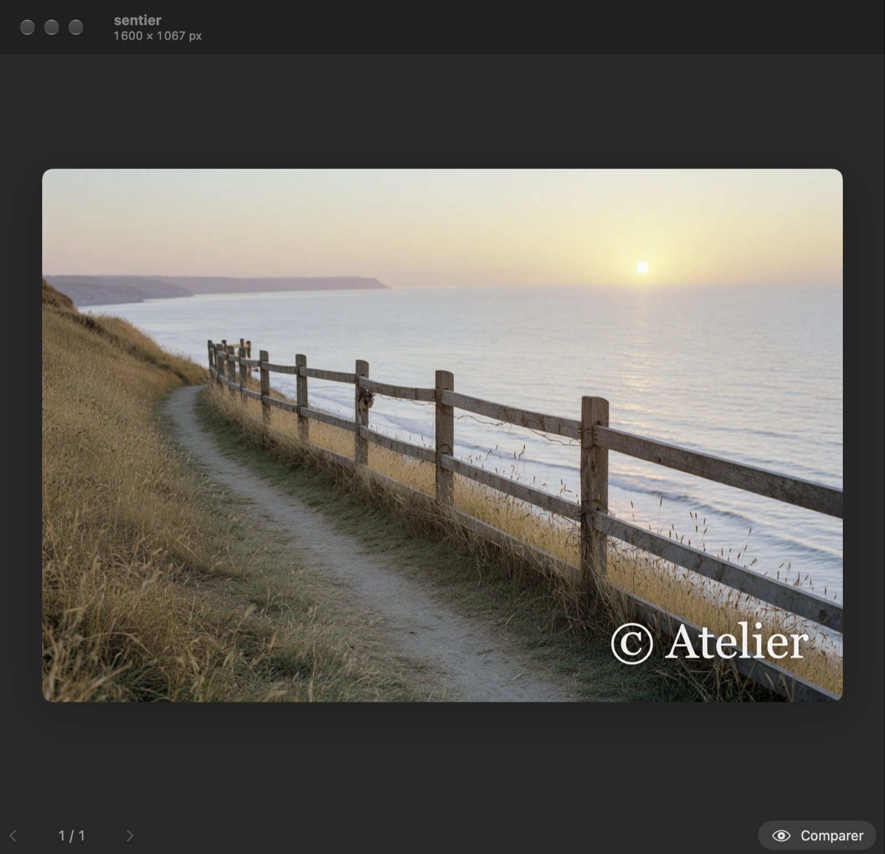
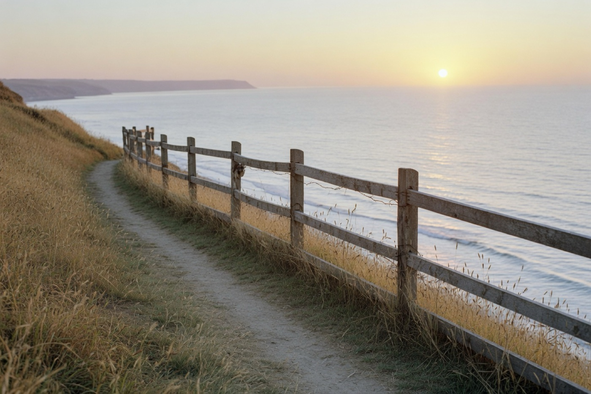
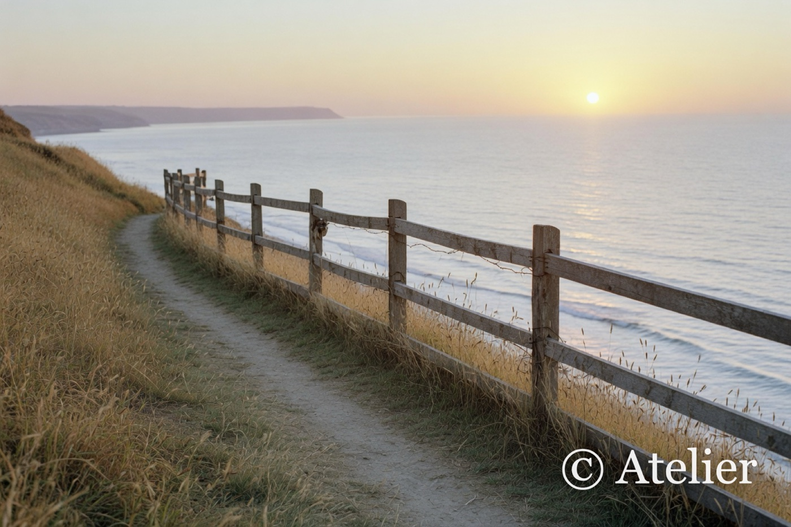

# Copyright Inserter

Une marque sur tout un dossier de photos. Les originaux restent où ils sont.

<p align="center">
  
</p>

Le titre est le nom du fichier. En dessous, la taille réelle de la copie. Ici la largeur est fixée à 1 600 px : la hauteur suit le ratio, puis la marque se pose sur cette image. L’inspecteur, à droite, porte les réglages. Maintenir **Comparer** montre l’original.

## Avant, après

Même photo, une fois ramenée à 1 600 px de large. La marque est une proportion de cette largeur, pas de l’original.

| Avant | Après |
| :---: | :---: |
|  |  |

## Fonctionnalités

**Marque.** Une image, de préférence un PNG transparent, ou une ligne de texte en blanc, ivoire ou noir. Neuf positions, ou un glisser directement sur l’aperçu. Opacité, taille, marge et ombre portée.

**Format.** Taille d’origine, largeur fixe ou hauteur fixe. L’autre côté suit le ratio. La marque est posée après ce redimensionnement, donc elle a la bonne taille sur le fichier enregistré. Quatre préréglages : 800, 1 200, 1 600 et 1 920 px.

**Dossiers.** Un dossier de photos, et une destination facultative. Sans destination, chaque copie s’écrit à côté de l’original avec le préfixe `c_`. Les originaux ne sont pas modifiés. Un second passage ignore les fichiers déjà préfixés. JPEG, PNG, TIFF, GIF, BMP, HEIC et WebP.

**Copies.** Qualité JPEG réglable. Les blocs EXIF, IPTC et TIFF sont repris. Les coordonnées GPS sont retirées, sauf si on demande à les garder. Une progression suit le dossier, puis **Révéler** ouvre le résultat dans le Finder. Les réglages restent d’une fois sur l’autre.

**Fenêtre.** Apple Silicon, macOS 26 ou plus récent. Barre d’outils unifiée, verre liquide et inspecteur, dans l’apparence du Mac. ⌘↩ pose la marque, ⌘I affiche l’inspecteur, ⌘← et ⌘→ changent de photo.

## Construire

```bash
./build.sh
```

Le script teste le compositeur, signe `dist/Copyright Inserter.app` et écrit une image disque dans le dossier parent. Xcode ou les outils de ligne de commande Apple suffisent.
